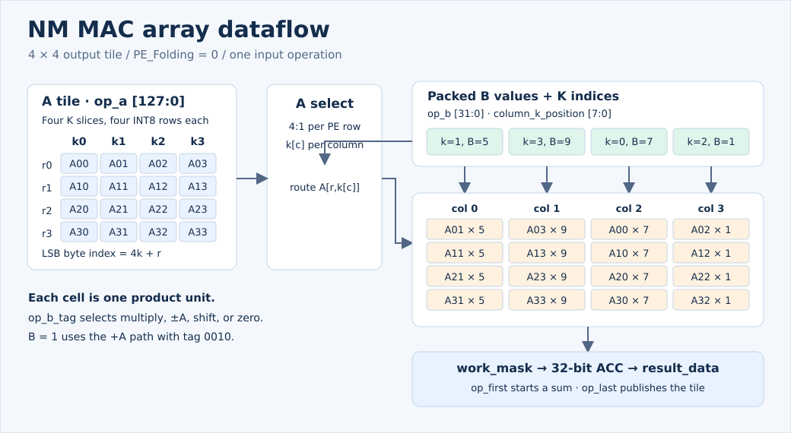

# NM MAC array

그림은 기본 4×4 구성에서 `PE_Folding=0`일 때 입력 한 건을 처리하는 예입니다. B의 K 인덱스는 열 순서대로 1, 3, 0, 2이고 B 값은 5, 9, 7, 1입니다. 첫 번째 열의 PE는 각 행에서 `A[r,1]`을 골라 5와 곱합니다. 나머지 열도 같은 방식으로 각자의 K 인덱스를 사용합니다.

## RTL 구현

1. **A 선택** — 각 열 `c`에서 `column_k_position[2*c +: 2]`로 K 인덱스를 읽습니다. A는 K별로 묶여 있어 기본 구성에서 `A[r,k]`는 `op_a[8*(4*k+r) +: 8]`에 들어 있습니다.
2. **Product** — 같은 열의 PE가 INT8 B 값과 4비트 `op_b_tag`를 공유합니다. 일반 곱셈은 radix-4 Booth와 CSA를 사용합니다. 나머지 tag는 +A, −A, 좌시프트 또는 0을 선택합니다.
3. **누산과 출력** — `work_mask`가 유효한 PE의 16비트 곱을 부호 확장해 32비트 ACC에 더합니다. `op_first`에서 합을 0부터 시작하고, `op_last`에서 행 우선 순서로 결과를 내보냅니다. `op_rows`와 `op_cols`는 타일의 유효 행과 열을 지정합니다.
4. **옵션** — 기본 4×4에서 `PE_Folding=1`이면 8개 product 유닛을 두 phase에 걸쳐 재사용합니다. `ACC_dup=1`이면 `REUSE=4`에 따라 최대 네 타일의 부분합을 별도 bank에 저장합니다.

[mac_array_compute_nm.v](mac_array_compute_nm.v)
