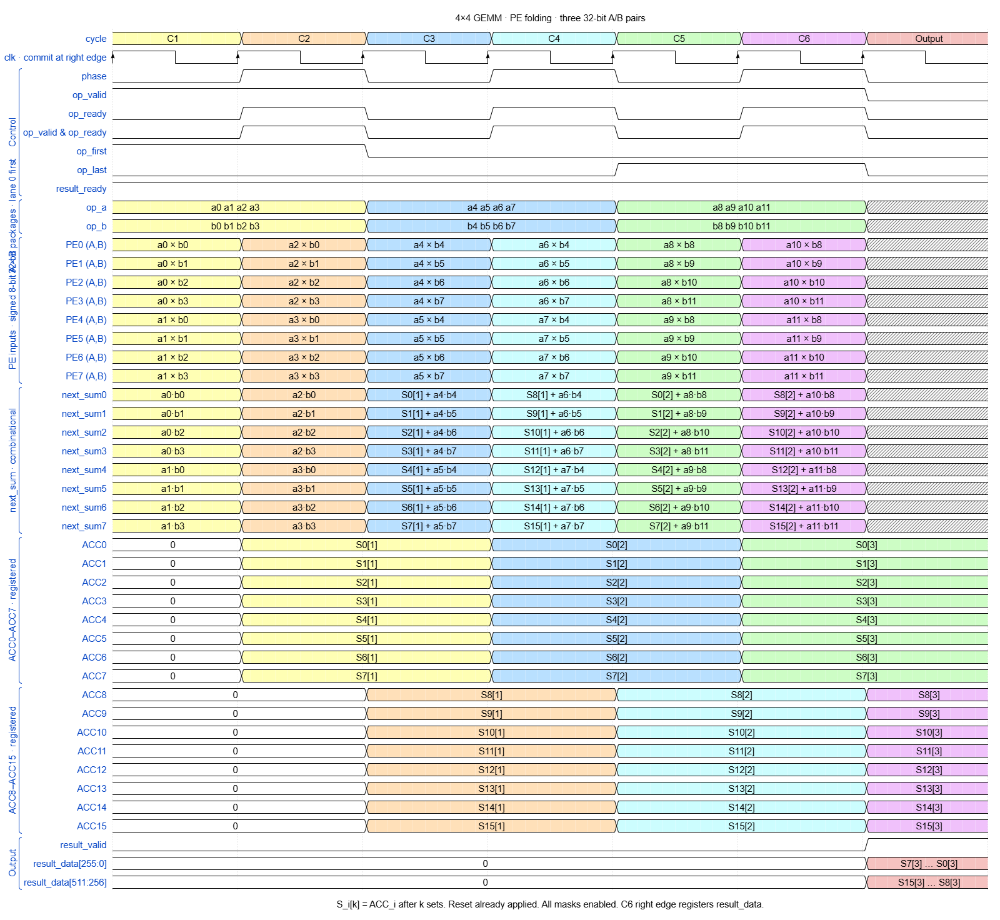

# BTB GEMM Compute/Pipeline

Break the Bottleneck 프로젝트의 GEMM MAC array RTL 및 검증 소스입니다.

| 설계 | RTL | 용도 |
| --- | --- | --- |
| Compute v1 | [mac_array_compute.v](rtl/mac_array/mac_array_compute.v) | ACC duplication, PE folding, product 경로 통합 |
| Compute v2 | [mac_array_compute_v2.v](rtl/mac_array/mac_array_compute_v2.v) | Sparsity 팀의 nonzero 정보와 B tag 연결 |
| Accumulator duplication | [mac_array_acc_duplicated.v](rtl/mac_array/mac_array_acc_duplicated.v) | ACC duplication 단독 비교 |
| PE folding | [mac_array_PE_folding.v](rtl/mac_array/mac_array_PE_folding.v) | PE folding 단독 비교 |
| Product module passing | [mac_array_path.v](rtl/mac_array/mac_array_path.v) | multiplier와 B 특수값 경로 단독 비교 |
## Accmulator duplication(Data_reuse) [target : buffer size가 모든 input을 커버하지 못할때 memory access의 횟수를 줄인다 ]
결정해야할 변수 : REUSE 횟수, 어떤 data (A,B)

진행할simulation option 정리 / 사용한 testbench file, other module file 명

### mac_array 입력 순서 규약
bank 번호는 별도 포트 없이 **op 순서**로 정해진다. 상위 모듈(gemm_control, operand_loader)은 아래 순서를 지켜야 한다.

| 구간 | 공급 순서 | bank 선택 |
| --- | --- | --- |
| 그룹 첫 k | 타일 0..S-1을 `op_first=1`로 차례로 공급 | 그룹 시작(`op_first && 직전 op_last`)이면 0, 이후 `op_first`마다 +1. 마지막 번호를 `grp_last`에 기록 |
| 중간 k | 같은 타일 순서로 공급 | +1, `grp_last` 다음은 0으로 순환 |
| 마지막 k | 같은 순서, 각 타일 `op_last=1` | 타일마다 결과 출력 |

- 그룹 크기 S는 첫 k에서 `op_first`가 들어온 개수로 자동으로 정해진다. 따라서 `REUSE` 이하에서 **세트 수를 런타임에 바꿔도 mac_array는 수정할 필요가 없다.**
- 어느 operand(A/B)를 재사용할지도 공급 순서로 정해진다(아래 표).

### 결정해야 할 변수

**1. 재사용 데이터 (방향)**

| | A 재사용 (A 방향) | B 재사용 (B 방향) |
| --- | --- | --- |
| 그룹으로 묶는 타일 | 같은 행, 열 타일 S개 | 같은 열, 행 타일 S개 |
| loader가 고정하는 값 | `op_a` | `op_b` |
| 줄어드는 외부 읽기 | A | B |
| 함께 필요한 것 | B 열 타일 S개 공급 | A 행 타일 S개 (A 버퍼 4·S·K B) |
| 구현 상태 | RTL 실측 완료 (`rtl_acc_r2/r3/r4/r8`, control `A_REUSE`) | 미구현 (Memory팀 flexible A 버퍼 이후) |

Set 3 그룹 루프는 A 캐시로 A를 이미 재사용하므로, A 방향 복제와 함께 쓰면 이득이 겹친다. 그룹 루프와 보완 관계인 것은 B 방향이다.

## PE folding [target : cycle pipelining /Area reduce]
timing diagram 
(관련 설명 추가)

진행할 시뮬레이션 option 정리

## Product module passing [targete : power]
단순 simulation 상에서 확인 불가능

-> sparsity team의 module처럼 is_{specialcase} event 신호를 추가하면 특수 case에 대한 빈번함? 체크 가능 

## mac_array_compute.v

ACC duplication, PE folding, product 경로를 한 모듈에 묶었습니다. `ACC_dup`과 `PE_Folding`은 인스턴스에서 각각 설정합니다.

| Global parameter | 기본값 | `0` (OFF) | `1` (ON) |
| --- | --- | --- | --- |
| `PE_Folding` | `0` | 16개 product 유닛으로 4×4 타일을 한 phase에 처리 | 8개 product 유닛을 재사용해 위쪽 2행과 아래쪽 2행을 두 phase로 처리 |
| `ACC_dup` | `0` | ACC bank 0만 사용 | 타일별 부분합을 별도 ACC bank에 저장. K-outer 순서로 입력을 공급하며, 한 그룹에서 최대 8개 타일 처리 |

### `REUSE` localparam

| 설정 | 기본값 | 동작 |
| --- | --- | --- |
| `REUSE` | `8` | `ACC_dup=1`일 때 한 그룹에서 ACC bank 0~7에 최대 8개 타일의 부분합을 따로 저장합니다. `ACC_dup=0`이면 bank 0만 사용합니다. |

`REUSE`는 RTL에서 수정합니다. A/B 중 어느 데이터를 재사용할지는 상위 모듈의 입력 공급 순서로 정합니다.

## mac_array_compute_v2.v — sparsity 출력 연결
v1의 compute 구조에 sparsity 팀의 출력 처리 로직을 추가했습니다.

1. **입력 포트** — `op_a_nz[r]`와 `op_b_nz[c]`를 추가했습니다. 현재 B 열의 활성 여부는 `op_b_tag[4*c +: 4] != 0`으로 판단합니다. `op_b_nz`는 선언만 되어 있습니다.
2. **PE별 연산 마스크** — `FACTORED_MASK=0`이면 기존 `work_mask[r*PE_COLS+c]`를 씁니다. `1`이면 `op_a_nz[r] && (op_b_tag[4*c +: 4] != 0)`으로 `work_enable`을 만든다. 타일 가장자리의 유효 행·열은 `op_rows`와 `op_cols`로 확인합니다.
3. **MAC 이벤트와 multiplier enable** — `event_mac`에는 `work_enable`과 현재 phase를 반영합니다. v2의 `event_nonzero_mac`은 여기에 A와 B 데이터가 모두 0이 아닌 조건을 더합니다. 이 신호와 일반 곱셈 tag(`4'b0001`)가 함께 들어올 때 Booth multiplier 입력을 활성화합니다. ±A와 시프트는 tag로 선택합니다.
4. **ACC 갱신** — 유효 PE에서 `op_first=1`이면 기존 부분합을 0부터 시작합니다. 이후 `work_enable=0`이면 ACC 값을 유지합니다. 유효 범위 밖의 PE는 0으로 처리합니다. Folded/Unfolded 경로 모두 같은 조건을 씁니다.

## 시뮬레이션 옵션

아래 값은 testbench나 상위 모듈에서 `mac_array_compute #(...)` 인스턴스를 만들 때 지정합니다. 두 파일 모두 `mac_array_compute`, `product`, `mul`을 정의하므로 한 빌드에 v1 또는 v2 중 하나만 넣습니다. GEMM 통합 시뮬레이션에는 프로젝트의 `gemm_top.v`와 `tb_gemm.sv`를 함께 사용합니다. 기존 top에서 `mac_array`를 인스턴스화하고 있다면 모듈 이름과 compute 포트 연결을 맞춥니다.

| 파라미터 | 적용 | 기본값 | 변경하면 |
| --- | --- | --- | --- |
| `FACTORED_MASK` | v2 | `0` | `0`은 `work_mask` 사용. `1`은 sparsity 쪽의 A nonzero 비트와 B tag 사용. |
| `PE_ROWS`, `PE_COLS` | v1, v2 | `4`, `4` | 포트와 결과 패킹 일부가 4행 고정이므로 이 버전의 비교는 4×4 기준으로 진행합니다. |

`REUSE=8`과 folding 시 `PHASE_ROWS=PE_ROWS/2`는 RTL의 `localparam`이다. 시뮬레이션 파라미터로 바로 덮어쓸 수 없습니다. Folding 제어는 두 phase를 기준으로 짜여 있습니다.
